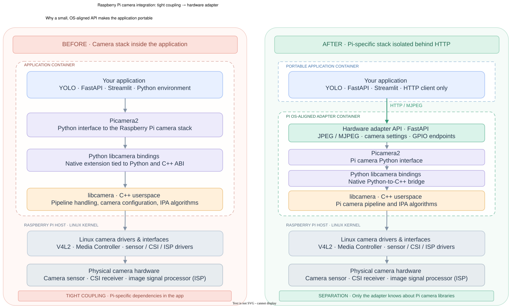

# Edge Hardware Service

**A small HTTP hardware boundary for Raspberry Pi edge AI applications.**

[](https://github.com/rasmushaa/edge-hardware-service/actions/workflows/ci.yaml)
[](https://github.com/rasmushaa/edge-hardware-service/releases/tag/v0.1.1rc1)
[](https://github.com/rasmushaa/edge-hardware-service/pkgs/container/edge-hardware-service)
[](https://rasmushaa.github.io/edge-hardware-service/)
[](LICENSE)

Edge Hardware Service exposes Raspberry Pi cameras and GPIO through a typed, versioned FastAPI interface.  
An edge inference application can consume camera frames and control pins  
without importing Picamera2, libcamera, GPIO Zero,  
or other Raspberry Pi-specific packages into its own environment.

## Why this exists

Picamera2 is coupled to native libcamera bindings, Linux camera drivers, and the Raspberry Pi OS package set.  
GPIO access has similar device, permissions, and provider constraints.  
Putting those dependencies inside an ML application makes its environment harder to reproduce, test, and run away from the Pi.  

This service moves that coupling behind one local network boundary:

- The Raspberry Pi owns the camera, GPIO devices, and native dependencies.
- Client applications depend only on HTTP, JSON, JPEG, and MJPEG contracts.
- A deterministic simulation backend exposes the same API on macOS, Linux,
  and CI without physical hardware.
- Runtime capability discovery adapts the camera API to the connected
  Picamera2-compatible device instead of using a model allowlist.

The result is a portable edge AI application and a small, independently
testable hardware service with one reason to change.



## Install and use

The generated API reference is the main user documentation. The current `main`
branch is published at <https://rasmushaa.github.io/edge-hardware-service/>.
When running the service locally, the same operations, request examples,
response schemas, and errors are available in Swagger at `/docs`.

The API is organized into three areas:

- Health checks for service readiness.
- Camera state, capabilities, settings, lifecycle, autofocus, images, and MJPEG.
- GPIO inspection, configuration, digital I/O, PWM, and pin release.

See the published API documentation for the complete endpoint reference.

### Run from the Python repository

Use this option for local development without Raspberry Pi hardware. Python
3.11 and [uv](https://docs.astral.sh/uv/) are required.

1. Clone, install, and run:

   ```shell
   git clone https://github.com/rasmushaa/edge-hardware-service.git
   cd edge-hardware-service
   uv sync
   uv run uvicorn edge_hardware_service.main:app --reload
   ```

2. See the Swagger docs at <http://localhost:8000/docs>.

This runs the simulation backend. No camera, GPIO devices, or Raspberry Pi
packages are needed.

### Pull and run the Docker image on a Raspberry Pi

Use a 64-bit Raspberry Pi OS Bookworm host with Docker installed.

1. Pull the image:

   ```shell
   docker pull ghcr.io/rasmushaa/edge-hardware-service:<version>-bookworm
   ```

2. Run it with hardware access enabled:

   ```shell
   docker run --rm \
     --name edge-hardware-service \
     --privileged \
     --volume /run/udev:/run/udev:ro \
     --publish 8000:8000 \
     --env EDGE_HARDWARE_SERVICE_BACKEND=rpi \
     ghcr.io/rasmushaa/edge-hardware-service:<version>-bookworm
   ```

3. See the Swagger docs at `http://<raspberry-pi-ip>:8000/docs`.

## Runtime model

| Environment variable | Values | Default | Purpose |
| --- | --- | --- | --- |
| `EDGE_HARDWARE_SERVICE_BACKEND` | `simulation`, `rpi` | `simulation` | Select deterministic adapters or physical Raspberry Pi providers. |

The service uses one Uvicorn worker because camera ownership, GPIO ownership,
and the pin registry are process-local. Do not scale this container by adding
workers. Scale client applications independently instead.

The physical camera adapter manages one active camera at a time. Index `0` is
the default; the connect endpoint can select another Picamera2 index. Camera
controls and metadata are discovered from the provider, and unsupported
optional controls fail without partially applying a settings patch.


## Development

Prerequisites for normal development are Python 3.11, uv, and Make. Docker with
Buildx is required for container tests and Raspberry Pi deployment. Start with:

```shell
make help
uv sync
make no-hw-test
```

Install the repository's local quality hooks once per clone:

```shell
uv run pre-commit install
```

Run all code-quality checks explicitly with:

```shell
uv run pre-commit run --all-files
```

The hooks check file hygiene, YAML and TOML validity, Python lint rules, import
ordering, and Ruff formatting. Raspberry Pi tests are intentionally opt-in.

## Testing strategy

The test layers answer different questions. A passing portable suite is not
presented as evidence that physical hardware works.

| Command | What it validates | What it does not validate |
| --- | --- | --- |
| `make no-hw-test` | Unit, simulation, service-policy, error-contract, and in-process API behavior in the local uv environment. | Raspberry Pi packages, containers, or devices. |
| `make no-hw-test-docker` | The same portable suite inside the ARM64 Bookworm test image with packaged native dependencies. | Device access or the production runtime process. |
| `make smoke-test` | An existing runtime image starts with simulation and returns the expected health response. | Camera or GPIO hardware behavior. |
| `make hw-test` | Native Raspberry Pi OS providers can exercise the selected real GPIO pins and connected camera. | Container device access or electrical measurements. |
| `make hw-test-docker` | The hardware-test image can access the same real GPIO and camera providers. | The deployed runtime HTTP API or electrical measurements. |

### Manual Raspberry Pi hardware tests

The hardware suites need three distinct, unconnected BCM pins for input,
digital output, and PWM, plus a camera visible to Picamera2. No external circuit
is required for the current checks.

> **Warning:** `make hw-test` and `make hw-test-docker` stop every running
> Docker container on the selected Raspberry Pi before testing. They do not
> restart unrelated containers afterward.

Run the suite natively on the Pi:

```shell
make hw-test
```

Run equivalent hardware coverage in the ARM64 test image:

```shell
make hw-test-docker
```

Both commands explain their effects and ask for the SSH target, safe pins,
camera confirmation, and permission before stopping containers. The native
command synchronizes the checkout and recreates the remote virtual environment.
The container command builds, transfers, and loads the hardware-test image, so
it can take several minutes over Wi-Fi.

## Build and ad hoc deployment

Build the `linux/arm64` runtime image and run it locally with simulation:

```shell
make build
```

This creates `edge-hardware-service:dev`, replaces the named local development
container, publishes port 8000, and stays attached. Press Ctrl+C to stop the
container; the built image remains available.

Deploy that local image over SSH to a Raspberry Pi:

> **Warning:** `make deploy` stops every running Docker container on the
> selected Raspberry Pi. It restarts only `edge-hardware-service`.

```shell
make deploy
```

The command transfers the image, starts the physical backend, and waits for
`/api/v1/health`. That health check proves process readiness only; use the
manual hardware suites to validate GPIO and camera access. This workflow is a
development convenience, not a production deployment system.

## CI/CD and releases

GitHub Actions applies the same separation of evidence:

- Every branch push and pull request runs pre-commit and the portable test
  suite on an ARM64 runner.
- Pull requests to `main` and commits on `main` also run the Bookworm container
  tests, build the runtime image, and smoke-test its health endpoint.
- GPIO and camera hardware tests remain manual because hosted runners do not
  have the required physical devices.

Release work starts through a version-only pull request:

```shell
make rc VERSION=0.1.2rc1
make release VERSION=0.1.2
```

These commands require an authenticated GitHub CLI, a clean `main` branch, and
a version newer than the project version and all release tags. They create a
release branch, update `pyproject.toml` and `uv.lock`, validate the change, and
open a pull request. They never push directly to `main` or create a local tag.

Merging the release PR authorizes the release workflow to:

1. Re-run the portable checks.
2. Build and smoke-test the runtime image.
3. Create the immutable `v<version>` Git tag.
4. Publish `ghcr.io/rasmushaa/edge-hardware-service:<version>-bookworm`.
5. Create the matching GitHub Release.

The badges at the top currently point to the `v0.1.1rc1` release candidate and
its `0.1.1rc1-bookworm` image. Release candidates do not update
`latest-bookworm`; when a stable release exists, that alias points to the
highest stable version. Consumers should pin an exact image tag for reproducible
deployments. The workflow detects partially completed releases and creates only
missing artifacts without moving an existing version tag.

## License

Released under the permissive [MIT License](LICENSE).
